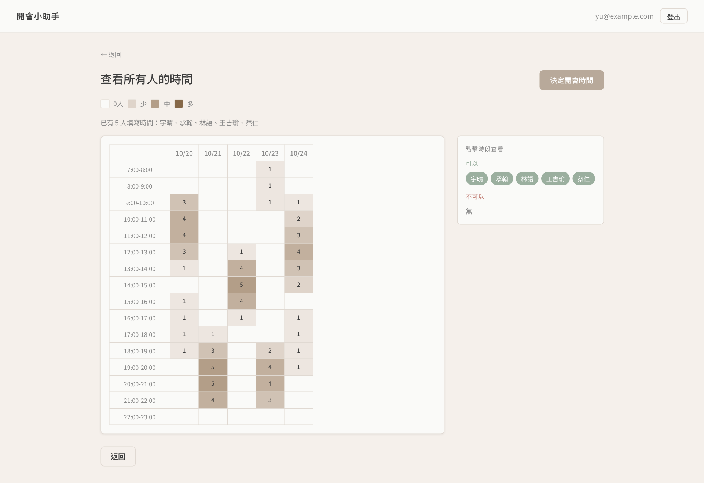
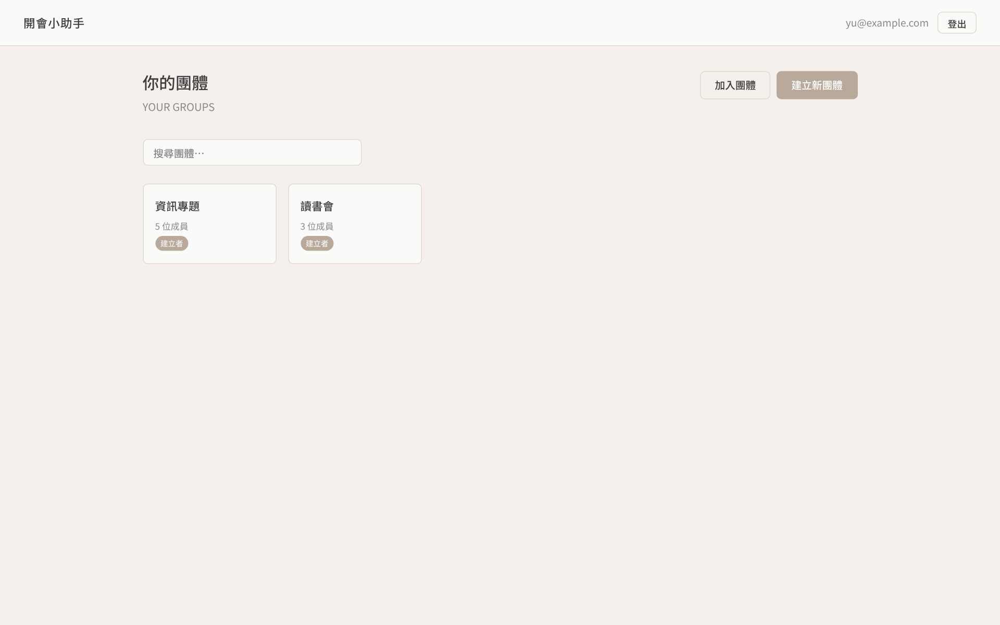
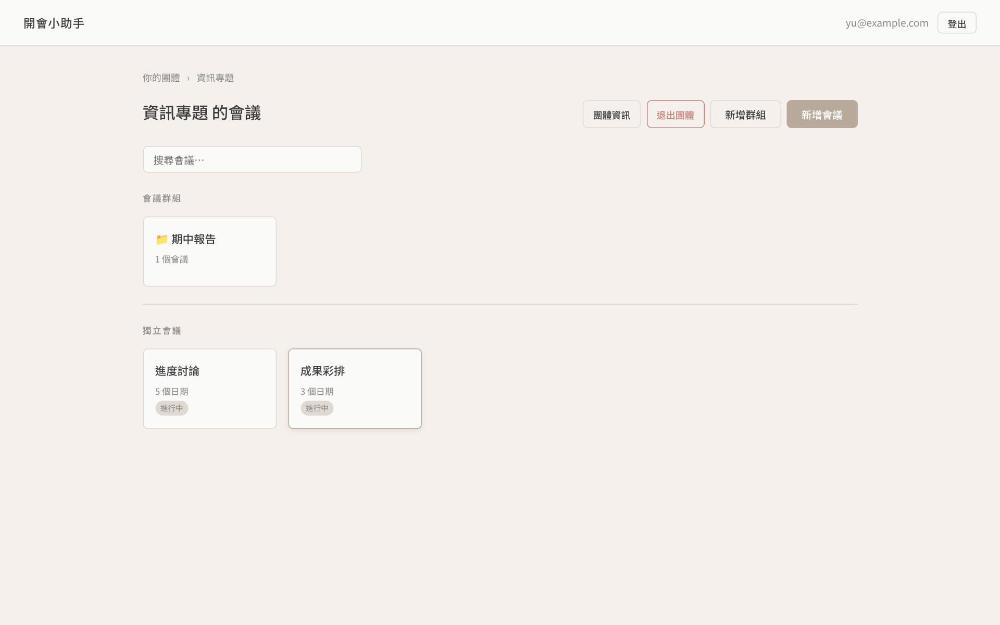
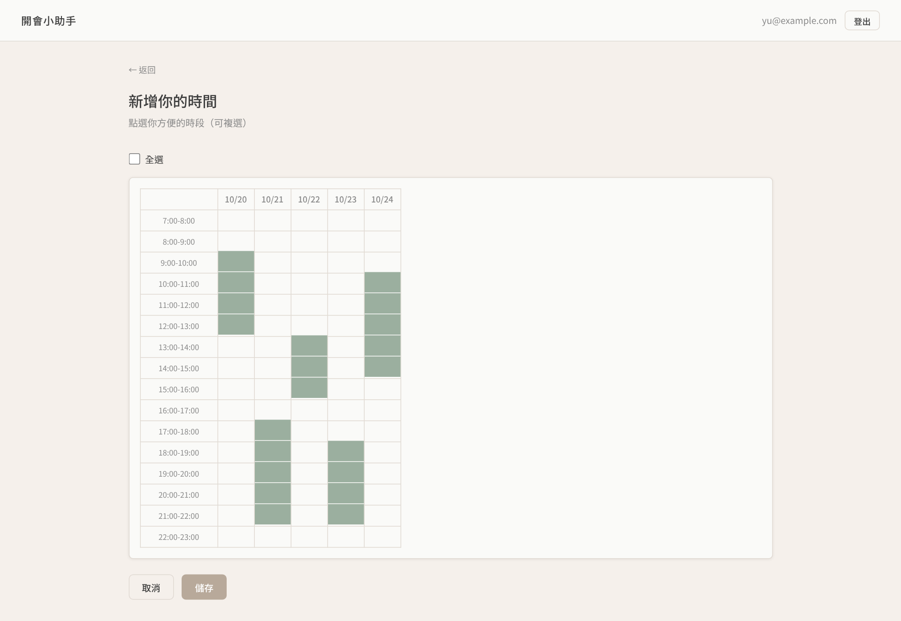
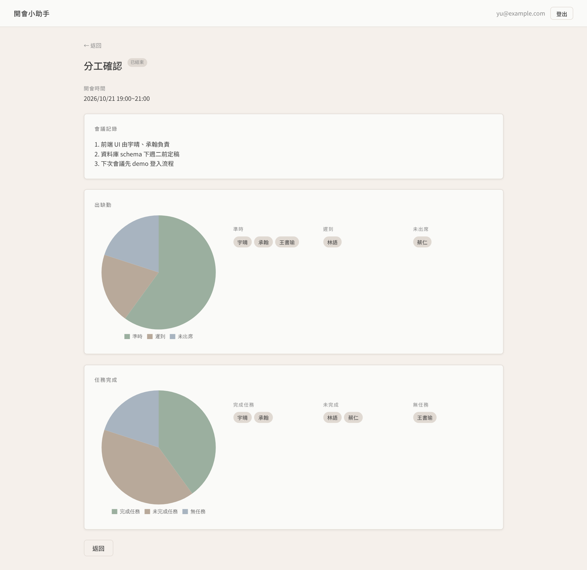

# 開會小助手 (Meeting Assistant)

[](https://github.com/ssuyu0829/meeting-assistant/actions/workflows/ci.yml)

> 日式極簡風格的線上會議排程與紀錄工具

解決的問題：社團與小組要喬開會時間時，訊息在群組裡來回洗版，最後還是沒人記得結論。
這個站把「填可用時段 → 熱力圖看交集 → 組長拍板並自動寄信 → 記出席與會議紀錄 → 產生總結」
收成一條線，每一步都留在同一個會議底下。



---

## 一、線上展示

**線上 Demo 目前暫停**（Render 免費方案的服務維護中）。
功能與權限邊界可由 `backend/tests/test_api.py` 與 CI 驗證，本機啟動方式見 [`HOW_TO_RUN.md`](HOW_TO_RUN.md)。

---

## 二、網站功能

### 1. 帳號系統
- 使用者註冊 / 登入（Email + 密碼）
- JWT Token 身份驗證，登入狀態保持 7 天

### 2. 團體管理
- 建立團體（擔任 Leader）
- 透過伺服器產生的邀請碼加入團體
- 查看團體成員清單、離開團體



### 3. 群組（資料夾）與會議管理
- 在團體內建立群組，分類整理會議
- 建立會議，設定多個候選日期
- 將會議標記為「已結束」



### 4. 時間填寫（可用時段調查）
- 每位成員填寫自己在各候選日期的可用時段（早上 7 點～晚上 11 點，共 16 個時段）
- 可一鍵全選、再逐格取消



### 5. 熱力圖（Heatmap）
- 以日期 × 時段的格子呈現有空的人數，顏色越深代表越多人
- 點任一格即可看到「誰可以、誰不可以」（見頁首截圖）

### 6. 確認開會時間 + 發送 Email 通知
- Leader 決定最終開會時間後，在背景透過 Resend 寄送通知 Email 給所有團體成員

### 7. 出席紀錄
- 記錄每位成員出席狀態：準時 / 遲到 / 缺席
- 記錄任務完成狀態：完成 / 未完成 / 無任務

### 8. 會議紀錄
- 填寫會議筆記與補充備注

### 9. 會議總結
- 統計出席率與任務完成率，以圓餅圖（Chart.js）呈現



---

## 三、使用的工具與技術

### 後端
| 套件 | 用途 |
|------|------|
| Python 3.11.9 | 主要程式語言 |
| FastAPI | 建立 REST API 伺服器、提供前端靜態檔 |
| SQLAlchemy 2.0 | ORM 資料庫操作 |
| python-jose | JWT Token 產生與驗證 |
| passlib + bcrypt | 密碼雜湊（bcrypt + SHA-256 預雜湊）|
| email-validator | 註冊時驗證 Email 格式（Pydantic `EmailStr`）|
| python-dotenv | 讀取環境變數（.env 檔）|
| Resend | 發送通知 Email 的 API 服務 |
| pytest + httpx | API 測試（`backend/tests/`）|
| ruff | Lint 與 import 排序，CI 會跑 |

### 資料庫
- **本地開發：** SQLite
- **正式部署：** PostgreSQL（由 Supabase 託管）
- psycopg2-binary — Python 連接 PostgreSQL 的驅動程式
- Supabase Connection Pooler（Session Pooler，port 5432）— 解決 Render 免費方案無法直連 Supabase 的網路問題

### 前端
- 純 HTML / CSS / JavaScript（無框架、無 build step）
- Chart.js — 繪製圓餅圖（出席率、任務完成率）
- Fetch API — 與後端 API 溝通
- **設計風格：** 無印良品 / 日式極簡，莫蘭迪色系
  - 主色：`#F5F0EB` 米白、`#B8A99A` 暖棕、`#9BAF9F` 鼠尾草綠、`#A8B4C0` 霧藍

### 部署與版本控制
- **GitHub** — 原始碼管理：https://github.com/ssuyu0829/meeting-assistant
- **GitHub Actions** — 每次 push / PR 自動跑 ruff 與 pytest
- **Render** — 雲端部署平台（免費方案），自動偵測 GitHub 推送並重新部署
- **Claude Code** — AI 輔助開發，負責程式撰寫與除錯

---

## 四、原始碼結構與各檔案說明

```
meeting-assistant/
│
├── README.md                   本文件
├── HOW_TO_RUN.md               本機啟動、接 Supabase / Resend、部署到 Render 的步驟
├── LICENSE                     MIT
├── render.yaml                 部署設定檔，告訴 Render 如何建置與啟動服務
├── .python-version             指定 Python 版本為 3.11.9（避免 Render 使用不相容的新版本）
├── .gitignore                  排除不上傳的檔案（.env、資料庫、虛擬環境等）
├── .github/workflows/ci.yml    CI：安裝依賴 → ruff check → pytest
├── docs/screenshots/           README 用的畫面截圖
│
├── backend/
│   ├── requirements.txt        正式環境的 Python 套件（版本固定）
│   ├── requirements-dev.txt    開發／CI 額外需要的套件（pytest、httpx、ruff）
│   ├── pyproject.toml          ruff 與 pytest 設定
│   ├── .env.example            環境變數範本，複製成 .env 後填值
│   ├── main.py                 程式進入點：啟動 FastAPI、載入所有路由、提供前端靜態檔案
│   ├── database.py             資料庫連線設定：建立 SQLAlchemy 引擎、連線池與 Session
│   ├── models.py               定義所有資料庫表格（User、Group、Meeting 等 9 個資料表）
│   ├── auth.py                 身份驗證邏輯：密碼雜湊、JWT Token 產生與驗證
│   ├── deps.py                 共用的權限檢查（團體成員、會議成員）
│   │
│   ├── routers/                API 路由（依功能分檔）
│   │   ├── auth.py             註冊、登入 API
│   │   ├── groups.py           團體 API（建立、加入、查詢、離開）
│   │   ├── meetings.py         會議 API（建立群組、建立會議、查詢、結束會議）
│   │   ├── availability.py     時間填寫 API（提交可用時段、查詢熱力圖資料）
│   │   └── records.py          紀錄 API（出席狀態、會議筆記、確認時間、發送 Email、總結）
│   │
│   ├── migrations/             手動執行的 SQL（目前只有索引），見〈已知限制〉
│   └── tests/test_api.py       API 回歸測試（認證、權限邊界、路徑遍歷、出席與總結）
│
└── frontend/
    ├── index.html              登入 / 註冊頁面
    ├── groups.html             團體列表頁面
    ├── meetings.html           團體內的群組與會議列表
    ├── meeting.html            單一會議首頁（顯示候選日期與成員填寫狀態）
    ├── availability.html       填寫個人可用時段頁面
    ├── heatmap.html            熱力圖頁面（視覺化呈現最佳時段、決定開會時間）
    ├── record.html             會議紀錄首頁（顯示決定時間、筆記入口）
    ├── attendance.html         出席狀態記錄頁面
    ├── notes.html              填寫會議筆記與備注頁面
    ├── summary.html            會議總結頁面（出席率與任務完成率圓餅圖）
    │
    └── static/
        ├── css/style.css       全站 CSS 樣式（莫蘭迪色系設計系統）
        └── js/api.js           前端 API 工具（所有與後端溝通的函式、Token 管理、HTML 轉義、Toast 通知）
```

---

## 五、環境變數說明

這些變數儲存在 Render 的 Environment 設定中，**絕對不能上傳到 GitHub**。

| 變數名稱 | 必填 | 用途 |
|----------|------|------|
| `SECRET_KEY` | 是 | JWT Token 簽名密鑰（任意長字串），沒設程式會刻意啟動失敗 |
| `DATABASE_URL` | 否 | PostgreSQL 連線字串（Supabase Session Pooler），格式 `postgresql://postgres.[REF]:[PASSWORD]@[HOST]:5432/postgres`；留空則用本地 SQLite |
| `ALLOWED_ORIGINS` | 否 | 以逗號分隔的允許來源，只有前後端不同網域時才需要；留空不開 CORS |
| `RESEND_API_KEY` | 否 | Resend 服務的 API 金鑰，用於發送通知 Email；留空則略過寄信 |
| `FROM_EMAIL` | 否 | 通知 Email 的寄件人地址，預設 `onboarding@resend.dev` |

> 本地開發時，複製 `backend/.env.example` 成 `backend/.env` 並填值。`.env` 已加入 `.gitignore`，不會被上傳到 GitHub。

---

## 六、本地開發與部署

完整步驟（建虛擬環境、接 Supabase、設定 Resend、部署到 Render）見 [`HOW_TO_RUN.md`](HOW_TO_RUN.md)。最短路徑：

```bash
cd backend
python -m venv venv && source venv/bin/activate
pip install -r requirements-dev.txt
cp .env.example .env            # 至少填 SECRET_KEY
uvicorn main:app --reload       # http://localhost:8000
```

推送到 GitHub 後 Render 會自動重新部署；若只改了 Render 的環境變數，需手動點 **Manual Deploy**。

---

## 七、系統架構

```
瀏覽器 (10 個靜態 HTML + api.js)
    │  HTTPS
    ▼
Render 反向代理  ── 憑證、休眠喚醒、環境變數
    │
    ▼
FastAPI (uvicorn)  單一服務同時做兩件事：
    ├─ /api/*            JSON API（22 個端點，20 個需要 JWT）
    └─ /{path}           送 frontend/ 底下的靜態檔（含路徑邊界檢查）
    │  SQLAlchemy + 連線池 (pool_pre_ping / pool_recycle)
    ▼
Supabase PostgreSQL   9 張表；Render 的磁碟是暫時的，所以資料不放本機
    │
    └─ 背景工作 → Resend 寄開會通知信
```

**為什麼靜態檔也由 FastAPI 送**：前後端同源，省掉 CORS 與第二個部署目標。
代價是要自己做路徑邊界檢查 —— 見下面〈安全性〉第 1 點，那正是我踩到的坑。

**請求生命週期**：`get_current_user`（驗 JWT）→ `require_meeting_member`（驗團體成員）→ router
→ SQLAlchemy Session（`get_db` 的 yield dependency，請求結束自動關閉）→ 回 Pydantic response model。

---

## 八、安全性：自己找出來並修掉的漏洞

比起宣稱「沒有漏洞」，這裡誠實記錄找到什麼、怎麼修、用什麼測試釘住。

### 1. 靜態檔路徑遍歷（可讀到 `.env`）
- **問題**：catch-all 路由直接 `os.path.join(frontend_dir, full_path)` 就送檔，沒有邊界檢查。
  本機實測 `GET /%2e%2e/backend/.env` 會把 `.env` 整份回傳 —— 裡面有 `SECRET_KEY` 與資料庫連線字串。
  （線上打同樣路徑回 400，是 Render 的代理先擋掉，**不是程式擋的**。）
- **修法**：`main.py` 的 `serve_frontend` 先 `resolve()`，確認目標在 `frontend/` 底下才送，否則回 `index.html`。
- **回歸測試**：`tests/test_api.py::test_no_path_traversal`（四種編碼寫法）。

### 2. availability 端點越權存取（IDOR）
- **問題**：`submit_availability` 與 `get_availability` 只檢查「會議存在」，沒檢查呼叫者是不是該團體成員。
  任何登入者猜到連號的 `meeting_id`，就能讀到別人團體的成員姓名與時段，甚至塞資料進去。
- **修法**：把成員檢查抽成 `deps.py::require_meeting_member` 這個 FastAPI dependency，兩個端點都掛上；
  之後新增端點只要掛 dependency，不必記得複製檢查邏輯。
- **回歸測試**：`tests/test_api.py::test_non_member_cannot_touch_availability`。

### 3. attendance / summary 端點同樣的越權問題
- **問題**：修完第 2 點後再掃一次，發現 `GET /api/records/{id}/attendance` 與 `/summary` 也只檢查會議存在，
  任何登入者都能讀到別人會議的出席名單與總結。另外出席狀態欄位是任意字串，送不合法的值會在 enum 轉換時炸 500。
- **修法**：兩個端點改掛 `require_meeting_member`；狀態欄位改成 enum 型別，不合法的值由 Pydantic 擋成 422；
  儲存出席時也只接受該團體成員的 `user_id`。
- **回歸測試**：`test_non_member_cannot_read_attendance_or_summary`、`test_attendance_rejects_invalid_status`、
  `test_attendance_only_for_group_members`。

### 4. 前端 XSS
- **問題**：團體名、會議名、成員名都是使用者輸入，前端直接用樣板字串塞進 `innerHTML`。
  成員取名 `` 就能在其他成員的瀏覽器執行腳本（拿到 localStorage 裡的 JWT）。
- **修法**：`api.js` 加 `escapeHtml()`，所有把使用者資料塞進 `innerHTML` 的地方一律先轉義。

### 其他已處理
- `SECRET_KEY` 拿掉預設值：沒設就啟動失敗（有預設值＝任何人拿公開原始碼就能偽造 token）
- 邀請碼改由伺服器 `secrets.token_urlsafe(9)` 產生（原本可自訂成 `lab-001` 這種猜得到的碼）
- 加入團體失敗每人 5 分鐘 10 次上限、密碼至少 8 碼、`IntegrityError` 回 409 而不是 500

### 已知仍未處理（誠實列出）
- 登入本身沒有限速（只有加入團體有）
- JWT 七天有效且無法撤銷；token 放在 localStorage，一旦有 XSS 就會外洩（上面第 4 點是目前的防線）
- 限速是行程內記憶體計數，多實例或重啟後失效

---

## 九、設計決策（為什麼這樣選）

| 決策 | 理由 |
|---|---|
| **密碼先 SHA-256 再 bcrypt** | bcrypt 只吃前 72 bytes，超過的部分會被靜默截斷。先做一次固定長度的 SHA-256 摘要就沒有這個上限，雜湊強度仍由 bcrypt 提供。 |
| **資料庫用 Supabase 而不是 Render 的磁碟** | Render 免費方案的檔案系統是暫時的，每次重新部署就會清空，SQLite 檔會連同資料一起消失。 |
| **前端不用框架** | 十個頁面、每頁一支表單，用純 HTML＋一個 `api.js` 就夠；不需要 build step，部署只有一個服務。 |
| **靜態檔由 FastAPI 自己送** | 前後端同源，省掉 CORS 與第二個部署目標；代價是要自己做路徑邊界檢查（見 `main.py` 的 `serve_frontend`）。 |
| **SECRET_KEY 不給預設值** | 有預設值就會有人帶著公開原始碼裡的字串上線，等於任何人都能偽造 token。寧可啟動失敗。 |
| **權限檢查做成 dependency** | 寫在每個 handler 裡的檢查會漏（第 2、3 個漏洞都是這樣來的）；做成 `Depends(require_meeting_member)` 後，漏掛一眼就看得出來。 |

---

## 十、已知限制與後續改進

- **JWT 有效期 7 天且無法撤銷**：登出只清掉瀏覽器的 token，伺服器端不做黑名單。
- **免費方案冷啟動**：閒置 15 分鐘後第一次開啟要等約 50 秒。
- **沒有寄信重試**：Resend 失敗只會寫進 log，不會重送。
- **schema 用 `create_all` 建立**：之後改欄位需要手動處理（`backend/migrations/` 是手動跑的 SQL），還沒導入 Alembic 之類的 migration 工具。
- **部分列表端點有 N+1 查詢**：例如列團體時每個團體各查一次成員數；資料量小看不出來，之後應改成 join 或 group by。
- **測試涵蓋認證、權限邊界、路徑遍歷與出席／總結**，熱力圖的彙總邏輯與寄信流程還沒有測試。

---

## 十一、測試與 Lint

```bash
cd backend
pip install -r requirements-dev.txt
ruff check .
SECRET_KEY=test-secret python -m pytest tests -q
```

測試會自己在系統暫存目錄建一個 SQLite 檔，跑完刪掉，不需要另外設定 `DATABASE_URL`。CI（GitHub Actions）在每次 push 與 PR 時跑同樣的兩道指令。

---

## 授權

MIT，見 [LICENSE](LICENSE)。
